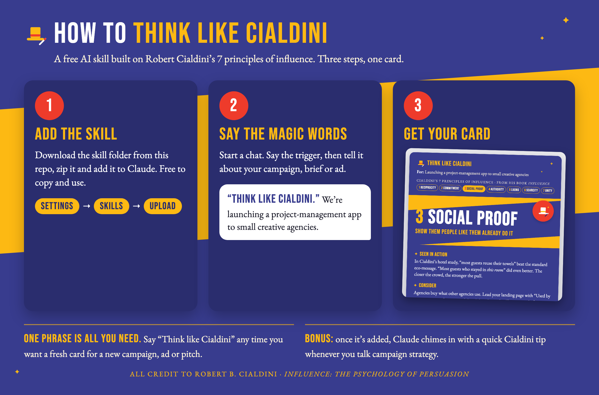
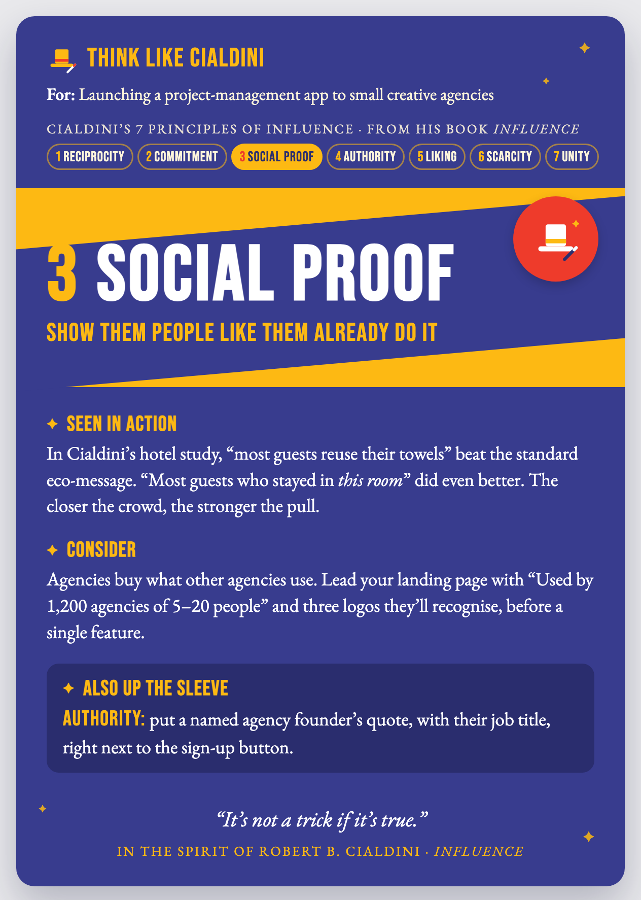

# Cialdini's 7 Principles of Influence: a free AI skill

**Robert Cialdini's 7 principles of influence, built into an AI skill to help marketing and sales teams persuade better.** Say *"think like Cialdini"*, tell it about your campaign, and get the one principle that will make the biggest difference, with the story from the book that proves it.

Free to copy, use and share.

[](docs/example-card.png)

*Click the image to see a full example card.*

## How to use it

### 1. Add the skill

**Claude (web or desktop app)**
1. Download this repo (green **Code** button → **Download ZIP**) and unzip it.
2. Zip up just the `cialdini-7-principles` folder.
3. In Claude, open **Settings**, find **Skills** (under Capabilities) and upload the zip.

**Claude Code:** copy the `cialdini-7-principles` folder into `~/.claude/skills/`.

**ChatGPT or Gemini:** create a Custom GPT (or a Gem). Paste the contents of `SKILL.md` into its instructions, and upload the files in `references/`, `examples/` and `assets/` as knowledge.

### 2. Say the magic words: "Think like Cialdini"

That's all you need to say. Follow it with your campaign, brief, ad or problem:

> **"Think like Cialdini.** We're launching a project-management app to small creative agencies."

You get a card with:
- **The principle**: the one of the 7 that will make the biggest difference to *your* campaign, lit up among all seven
- **Seen in action**: a quick story from Cialdini's books that shows it working
- **Consider**: why this principle fits your case, and exactly what to do
- **Also up the sleeve**: a second principle worth adding
- **A closing line** in Cialdini's spirit



In Claude.ai and the desktop app, the card is drawn in the colours of the book's cover, with a touch of magic. Elsewhere you get the same card as text.

### 3. Let it chime in

Once the skill is added, you don't always have to ask. When your chat turns to campaign strategy, messaging, a launch or sales outreach, Claude adds a short **🎩 Cialdini's corner** note: the principle that would make it more effective, and why. Once per chat, never pushy.

## What's inside

```
cialdini-7-principles/
├── SKILL.md              ← how the skill thinks: the card, the chime-in
│                            and the story bank
├── assets/
│   ├── card-template.html   ← the "Think like Cialdini" card design
│   ├── cialdini-7-principles.svg
│   └── influence-book-cover.jpg
├── references/           ← one file per principle: stories, evidence, famous
│   ├── reciprocity.md       examples, marketing and sales tactics, traps
│   ├── commitment.md
│   ├── social-proof.md
│   ├── authority.md
│   ├── liking.md
│   ├── scarcity.md
│   ├── unity.md
│   └── pre-suasion.md    ← bonus: the moment before the ask
└── examples/             ← two worked deep-dives on famous public work
```

Every principle comes with:
- **the stories from Cialdini's books** that prove it: Ethiopia repaying Mexico 50 years later, the Korean War prison camps, New Coke, the world's greatest car salesman's "I like you" cards…
- **the research evidence**: the hotel towel study, the restaurant mints, the cookie jar…
- **a famous campaign**, good or cautionary
- separate tactics for **marketing** and for **sales**
- **the traps**: fake scarcity, fake reviews and borrowed authority are things regulators fine brands for

## All credit to the legend: Robert Cialdini


Robert Cialdini spent years undercover, training as a car salesman, a fundraiser and an advertiser, to find out why people say yes. His book ***Influence: The Psychology of Persuasion*** (1984; New and Expanded edition, 2021) has sold over 5 million copies. It's still the most useful book a marketer or salesperson can read.

Charlie Munger, Warren Buffett's business partner at Berkshire Hathaway, called it "the book that I give most often as a present". He rated it so highly that he sent Cialdini a share of Berkshire stock as a thank-you. Cialdini later used Buffett's own 2015 shareholder letter as a textbook example of his 7th principle, unity.

This skill is built on Cialdini's work. The stories and research it tells come from his books. **Buy the book.** It's better than any summary.

<br clear="right">

📚 The books: [*Influence* (New and Expanded)](https://www.influenceatwork.com/) · [*Pre-Suasion*](https://www.influenceatwork.com/) · [The 7 principles explained by Influence at Work](https://www.influenceatwork.com/7-principles-of-persuasion/)


## Why I built it

I've spent years reading books on psychology and behavioural science, and how they apply to marketing and growth. It gets complicated fast. People make decisions through their memories, their emotions, their reasoning and a long list of cognitive biases. One popular map of biases lists nearly 200 of them.

Behavioural science also has a problem that's often called the replication crisis: plenty of famous findings haven't held up when other researchers tried to repeat them.

Cialdini's 7 principles stand out. They come from decades of research and real-world fieldwork, they've been studied and applied again and again, and they're easy to remember and use. Of everything I've read, this book has the most solid set of principles, and they're the ones I stand by.

They're the best starting anchor I've found: a strong foundation to build everything else on.

## Credits and copyright

The 7 principles are **Robert Cialdini's**: *Influence: The Psychology of Persuasion* (1984; New and Expanded edition, 2021) and *Pre-Suasion* (2016). See [influenceatwork.com](https://www.influenceatwork.com/). Studies are credited to their authors, with links in each reference file.

All writing, the card design and the 7-principles diagram are original. No text is copied from the books, courses or papers. The card's closing lines are written "in the spirit of" Cialdini. They're not his quotes. The cover of *Influence* (New and Expanded, Harper Business, 2021) is shown only to identify and credit the book. It remains the publisher's copyright. This project isn't affiliated with or endorsed by Robert Cialdini or Influence at Work.

© 2026 George Pohl. Free to copy, use and share under the [MIT licence](LICENSE).
