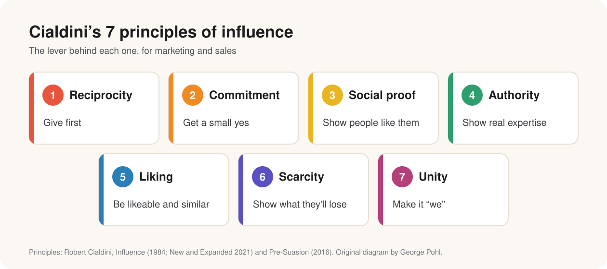
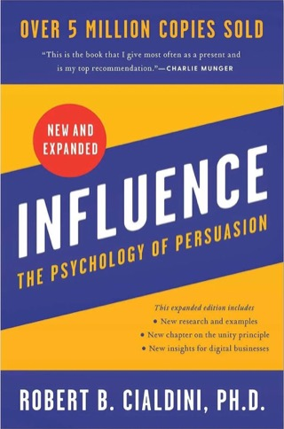

# Behavioural Science Marketing Skills

AI skills that put behavioural science to work on real marketing and sales. Paste in your ad, landing page, email or pitch, and get a blunt, evidence-backed critique with fixes you can use today.

**First up: Cialdini's 7 Principles of Influence for Marketing and Sales.**



## All credit to the legend: Robert Cialdini



Robert Cialdini spent years undercover, training as a car salesman, a fundraiser and an advertiser, to find out why people say yes. His book ***Influence: The Psychology of Persuasion*** (1984; New and Expanded edition, 2021) has sold over 5 million copies. It's still the most useful book a marketer or salesperson can read.

Charlie Munger, Warren Buffett's business partner at Berkshire Hathaway, called it "the book that I give most often as a present". He rated it so highly that he sent Cialdini a share of Berkshire stock as a thank-you. Cialdini later used Buffett's own 2015 shareholder letter as a textbook example of his 7th principle, unity.

This skill is built on Cialdini's work. The stories and research it tells come from his books. **Buy the book.** It's better than any summary.

<br clear="right">


📚 The books: [*Influence* (New and Expanded)](https://www.influenceatwork.com/) · [*Pre-Suasion*](https://www.influenceatwork.com/) · [The 7 principles explained by Influence at Work](https://www.influenceatwork.com/7-principles-of-persuasion/)

## What it does

Paste in any piece of marketing or sales material and the skill:

1. **Scores it against all 7 principles**: strong, weak, missing, not needed, or misused.
2. **Picks the 2–3 that matter most** for that audience and moment. Good work doesn't use all 7.
3. **Gives exactly 3 fixes**, each with a before-and-after rewrite.
4. **Runs an integrity check**, flagging fake scarcity, fake reviews and borrowed authority. These are things regulators fine brands for.
5. **Points you to the evidence**: the study, the famous example and the source.

Or describe a goal ("cold outreach to CFOs", "stop free trials churning") and it plans which principles to use, in which order, in which channel.

### A taste of the output

> **Verdict:** A near-perfect unity and social proof campaign… The weak spot is the step after the film: the ask is soft, so a lot of the goodwill has nowhere to go.
>
> **Fix 1: Give a tiny first step at the end** (Commitment)
> Before: "This Girl Can" + website
> After: "This Girl Can. Find a beginners' session near you this week, no kit needed."

Full worked examples:
- [Sport England, "This Girl Can"](cialdini-7-principles/examples/this-girl-can.md): a brand campaign
- [An online hotel booking page](cialdini-7-principles/examples/booking-hotel-page.md): conversion design, and where scarcity becomes a legal risk

## What's inside

```
cialdini-7-principles/
├── SKILL.md              ← how the skill thinks, scores and writes
├── assets/               ← the 7-principles diagram and the book cover
├── references/           ← one file per principle: stories, evidence, famous
│   ├── reciprocity.md       examples, marketing and sales tactics, traps
│   ├── commitment.md
│   ├── social-proof.md
│   ├── authority.md
│   ├── liking.md
│   ├── scarcity.md
│   ├── unity.md
│   └── pre-suasion.md    ← bonus: the moment before the ask
└── examples/             ← two worked audits of famous public work
```

Every principle comes with:
- **the stories from Cialdini's books** that prove it: Ethiopia repaying Mexico 50 years later, the Korean War prison camps, New Coke, the world's greatest car salesman's "I like you" cards…
- **the research evidence**: the hotel towel study, the restaurant mints, the cookie jar…
- **a famous campaign**, good or cautionary
- separate tactics for **marketing** and for **sales**

## How to use it

**Claude (web or desktop app)**
1. Download this repo (green **Code** button → **Download ZIP**) and unzip it.
2. Zip up just the `cialdini-7-principles` folder.
3. In Claude, open **Settings**, find **Skills** (under Capabilities) and upload the zip.
4. Start a chat and paste in your ad, page or email: *"Run a Cialdini audit on this."*

**Claude Code**
Copy the `cialdini-7-principles` folder into `~/.claude/skills/`.

**ChatGPT or Gemini**
Create a Custom GPT (or a Gem). Paste the contents of `SKILL.md` into its instructions, and upload the files in `references/` and `examples/` as knowledge.

## Why I built it

Most "persuasion checklists" stop at naming the principles. Real work needs judgement: which 2–3 levers fit this audience, how to phrase them, and where persuasion tips into manipulation. This skill turns what I've learnt from Cialdini, behavioural science and advertising effectiveness training into a repeatable critique that any marketer or salesperson can run in seconds.

More skills are on the way, including a wider behavioural science and advertising effectiveness skill (Binet & Field, Byron Sharp, Orlando Wood and more).

## Credits and copyright

The 7 principles are **Robert Cialdini's**: *Influence: The Psychology of Persuasion* (1984; New and Expanded edition, 2021) and *Pre-Suasion* (2016). See [influenceatwork.com](https://www.influenceatwork.com/). Studies are credited to their authors, with links in each reference file.

All writing and the 7-principles diagram are original summaries and applications of these ideas. No text is copied from the books, courses or papers. The cover of *Influence* (New and Expanded, Harper Business, 2021) is shown only to identify and credit the book. It remains the publisher's copyright. This project isn't affiliated with or endorsed by Robert Cialdini or Influence at Work.

Code and text: [MIT licence](LICENSE).

---

Built by **George Pohl**, growth marketer (acquisition, B2B, ABM, HubSpot). Part of a portfolio of simple AI tools for marketers, each with one job.
